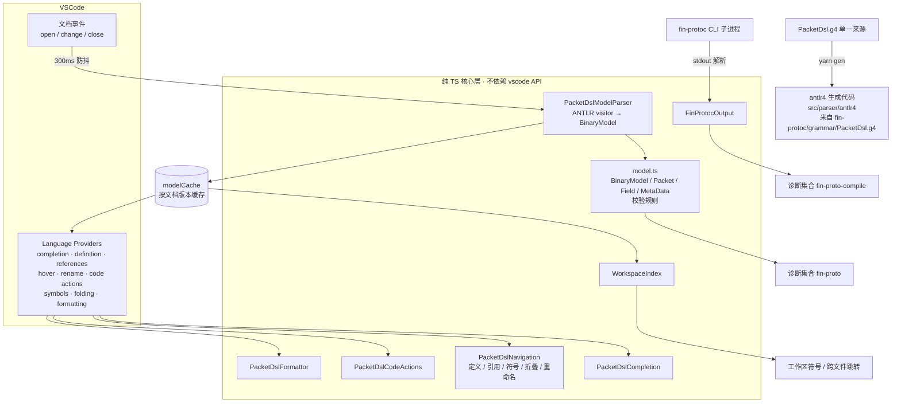

# FinProto VSCode 设计文档

本文面向插件的开发者与维护者，说明整体架构、模块职责、关键约定以及重要设计决策的背景与取舍。

## 1. 目标与边界

为 PacketDSL（`.pdsl` / `.dsl`）提供完整的 IDE 支持：语法高亮、诊断、补全、导航、重构、格式化、编译集成。

**边界**：插件不做协议语义的"编译"，编译由 fin-protoc CLI 完成；插件负责让书写和检错尽量在前端闭环。诊断校验可以比编译器更严，但**绝不能放过编译器接受的代码**（见 [§6 校验语义对齐](#6-校验语义对齐)）。

## 2. 整体架构

插件运行在 VSCode 扩展宿主内，所有语言能力基于进程内 ANTLR 解析，**无独立语言服务进程（不使用 LSP）**。



要点：

- **纯 TS 核心层**（`src/parser/*` 除 `antlr4/` 生成代码外）不 import `vscode`，全部可被 jest 单测覆盖，未来也可被 fin-protoc 复用或编译为 WASI 模块；
- `extension.ts` 是唯一的 vscode API 接线层，只做三件事：注册 Provider、维护缓存/索引、适配数据结构。

## 3. 模块职责

| 模块 | 职责 | 关键入口 |
| --- | --- | --- |
| `src/extension.ts` | Provider 注册、文档事件、诊断防抖、modelCache、编译命令、fin-protoc 子进程 | `activate()` |
| `src/parser/model.ts` | 数据模型（`BinaryModel`/`Packet`/`Field`/`MetaData`/`MatchPair`）与全部语义校验规则 | `BinaryModel.validate()` |
| `src/parser/PacketDslModelParser.ts` | ANTLR parse tree → `BinaryModel`，捕获各语法元素的精确位置 | `parsePacketDsl(text)` |
| `src/parser/PacketDslFormattor.ts` | 基于 AST 的全文/分段格式化，保留行注释 | `formatDsl()` / `formatDslSegments()` |
| `src/parser/PacketDslCompletion.ts` | 上下文感知补全（纯文本+模型推断位置语义） | `computeCompletions()` |
| `src/parser/PacketDslNavigation.ts` | 跳转定义、引用收集、文档符号、折叠区间、重命名、碰撞检测 | `resolveDefinition()` / `collectReferences()` / `buildDocumentSymbols()` / `computeFoldingRanges()` / `computeRename()` / `detectRenameCollision()` |
| `src/parser/PacketDslCodeActions.ts` | 快速修复（骨架生成、补逗号） | `buildQuickFixes()` |
| `src/parser/WorkspaceIndex.ts` | 工作区级模型索引：符号搜索、跨文件定义回退 | `searchSymbols()` / `resolveInWorkspace()` |
| `src/parser/FinProtocOutput.ts` | 解析 fin-protoc CLI 错误输出为可定位诊断 | `parseCompileErrors()` |
| `src/parser/antlr4/*` | ANTLR4ts 生成代码，**勿手改** | — |
| `src/test/suite/` | 集成测试（真实 VSCode 实例） | `extension.test.ts` |

## 4. 关键数据流

### 4.1 编辑 → 诊断

```
onDidChangeTextDocument
  → 清除该文档的 fin-proto-compile 诊断（已过期）
  → 300ms 防抖
  → parsePacketDsl(全文)          # ANTLR 语法错误 + visitor 语义校验
  → modelCache[uri] = { version, model }
  → workspaceIndex.update(uri, model)
  → model.syntaxErrors → 诊断集合 fin-proto
```

防抖回调内按文档版本取缓存，补全/导航等 Provider 复用同一份解析结果，**一次击键只解析一次**。

### 4.2 名称解析优先级（definition / hover / references 共用）

`resolveDefinition(model, word, cursorLine)` 的查找顺序：

1. 光标所在 packet 内的字段（含内嵌对象递归）
2. `metaDataMap` 成员
3. MetaData 块名（复合类型）
4. `packetMaps` packet

顺序决定了同名冲突时的语义（内层引用优先于全局名）。

### 4.3 引用收集（references / highlight / rename 共用）

`collectReferences` 是引用类功能的单一来源，按符号类型收集：

| 符号 | 声明处引用点 |
| --- | --- |
| packet | `match` 分派值（模型精确位置） |
| field | match key + `@lengthOf(...)` / `@calculatedFrom("...")` 参数（正则扫描原文，带单词边界） |
| MetaData 块/成员 | 字段的 `declaredType` token、meta 条目的 `type` token |

重命名 = `collectReferences` 全量替换；查找引用 = 过滤掉 declaration；同文件高亮 = 全量高亮。

## 5. 坐标系约定（易错，务必遵守）

模型与 Provider 之间存在**两套坐标**，所有跨层传递必须显式换算：

| 层 | line | col |
| --- | --- | --- |
| ANTLR token（`token.line` / `token.charPositionInLine`） | 1-based | 0-based |
| 模型字段（`Field.nameLine/nameCol` 等） | **1-based** | **0-based**（与 ANTLR 一致，不做转换） |
| vscode API（`Position` / `Range` / 诊断） | **0-based** | 0-based |

因此 Provider 层统一做 `line - 1`。`DslSyntaxError` 的 `startIndex/stopIndex` 语义是**同一行内的列区间**（start 列、end 列），不是字符流偏移；`Field.stopIndex` 等按"起始列 + token 区间宽度"近似计算，跨行字段（如 match 块）的 end 列不可靠，但诊断只会落在起始行，可接受。

新增模型位置字段时，一律直接存 ANTLR token 的原始值，转换只发生在 `extension.ts`。

## 6. 校验语义对齐

插件与 fin-protoc 共享同一份 grammar（单一来源在 fin-protoc 子模块，`yarn gen` 拷贝生成）。校验规则对齐原则：

1. **以编译器行为为准**：编译器接受的代码插件不能报错。例：MetaData 块名是合法的复合类型（Go 侧 `MetaDataMap` 只登记块内声明、块名另册），`@calculatedFrom("CRC32")` 是**校验算法名**而非字段引用（Go 侧 `ChecksumServiceFactory.getChecksumService`），均不做字段存在性校验。
2. **插件可以更严**：编译器不检查的引用目标存在性（`Unknown lengthOf target` / `Unknown match key`）插件检查了——这些错误编译阶段必然失败，提前到编辑期没有误报风险。
3. **语法变更流程**：改 g4（在 fin-protoc 仓库）→ 提交子模块指针 → `yarn gen` → 适配 visitor → 对齐校验 → 更新测试。

## 7. 设计决策记录（ADR）

### ADR-1 进程内 ANTLR，不引入 LSP

当前文件规模为千行级（fin-proto 最大协议文件约几百行），进程内解析 <10ms，无跨进程开销。LSP 意味着独立的语言服务进程、协议层、发布两个组件——对单插件是负收益。若未来出现万行级文件或非 VSCode 编辑器需求，再评估将核心层包成 LSP server（核心层不依赖 vscode API 正是为此预留）。

### ADR-2 编译集成走 CLI 子进程，FFI 已评估并否决

fin-protoc 通过 `spawn('fin-protoc compile -f …')` 调用，`finProto.protocPath` 可配路径。FFI（c-shared + koffi）可行但被否决：cgo 交叉编译分发成本高、Go runtime 嵌入编辑器进程的信号/内存风险、手动内存管理协议。若未来需要"保存即编译"的低延迟场景，优先路线是 **Go → WASI（`@vscode/wasm-wasi`）**，纯 Go 代码迁移成本可控且天然解决跨平台分发。

### ADR-3 多文件：索引不放宽

fin-proto 仓库的实践是**每个 .pdsl 自包含**（options/MetaData/packet 全在一个文件，编译器也是单文件编译）。因此：

- 校验**保持单文件严格语义**，不做"跨文件引用合法化"——否则插件会放过编译器拒绝的代码，违反 §6 原则 1；
- 工作区索引（`WorkspaceIndex`）只服务于**导航类功能**：Ctrl+T 符号搜索、当前文件无定义时的跳转回退。

### ADR-4 核心层与 vscode API 解耦

`src/parser/*` 禁止 import `vscode`（CI 由 eslint + jest 保证可运行）。收益：单测无需 mock vscode、集成测试降速不拖累开发反馈、核心层可被其它宿主复用。历史教训：formatter 曾残留 `import { FoldingRange } from 'vscode'`，已移除。

### ADR-5 语法错误时的降级策略

- **格式化**：语法错误时返回原文（绝不动用户无法解析的代码）；
- **分段格式化**：语法错误时返回空编辑集；
- **诊断**：语法错误与语义校验结果合并输出——语义校验基于部分成功的 parse tree，语法错误不阻断语义检查。

### ADR-6 补全的上下文推断是启发式

补全位置语义（类型位/字段名位/顶层/块内）由"行内 token 数 + 花括号深度 + 所在块类型"推断，不依赖 parser 的精确上下文（补全请求时宁可重扫文本也不重解析）。花括号深度计算会剥离字符串与注释，规避描述文本里的 `{` 干扰。该启发式的边界情况（如 `as` 关键字后）表现为返回空候选，宁可少不可错。

## 8. 测试策略

| 层 | 工具 | 覆盖 |
| --- | --- | --- |
| 纯逻辑单测 | jest（`src/__tests__/`） | parser 校验规则、formatter、补全、导航、重命名、quick fix、编译输出解析、工作区索引 |
| 集成测试 | @vscode/test-cli（`src/test/suite/`） | Provider 注册与端到端行为：诊断出现、补全/定义/引用/重命名/格式化/工作区符号经真实 VSCode 命令验证 |

约定：

- **新增能力先写纯逻辑 + 单测**，vscode 接线层尽量薄；
- 集成测试加载的是 `dist/extension.js`（esbuild 产物），`test-integration` 脚本已包含 `node esbuild.js`，**改完 extension.ts 必须走脚本跑集成测试**，勿只跑 jest；
- CI（GitHub Actions，Node 20 + xvfb）：单测 → 编译 → 集成测试 → `vsce package` → 上传 vsix artifact。

## 9. 已知限制与路线图

已知限制：

- 诊断的 end 列对跨行字段（match 块）不准确（见 §5）；
- 重命名/引用**仅限单文件**（与单文件自包含约定一致，跨文件引用本身不受编译器支持）；
- 补全上下文为启发式（ADR-6）；
- 编译需要用户自备 fin-protoc 二进制。

路线图（P2，按需启动）：

1. **fin-protoc 二进制分发**：CI 全平台 release + 插件首次激活检测缺失并引导下载（零配置体验的关键）；
2. **编译增强**：保存自动重编译（watch）、workspace 批量编译；
3. **Semantic Tokens**：基于 AST 的精确着色（match key、类型别名区分）；
4. **Inlay Hints**：packet 字段的字节偏移/大小提示，辅助二进制协议调试；
5. 大文件场景（万行级）再评估增量解析 / LSP（ADR-1）。
